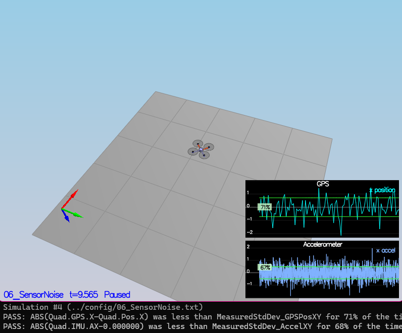
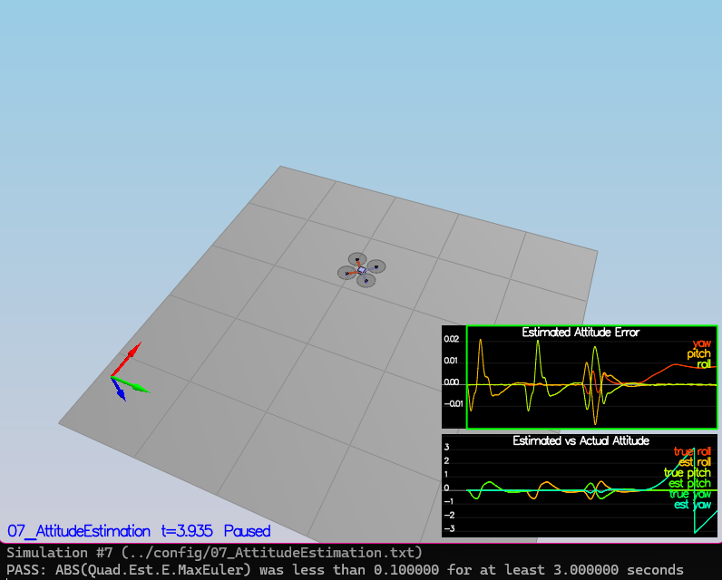
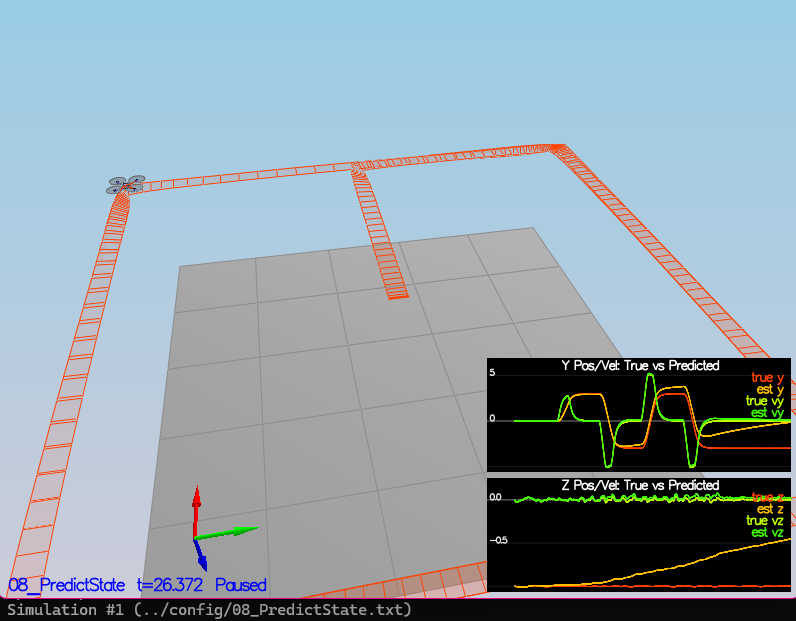
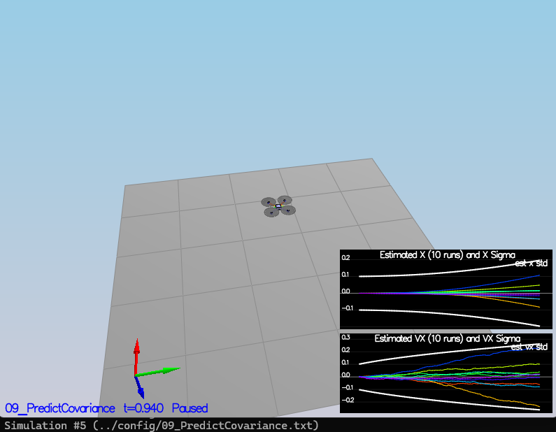
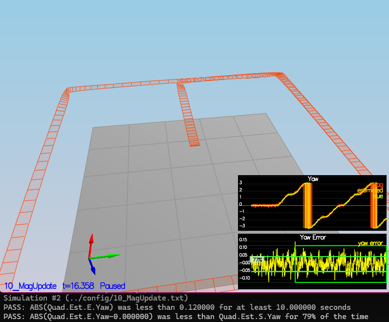
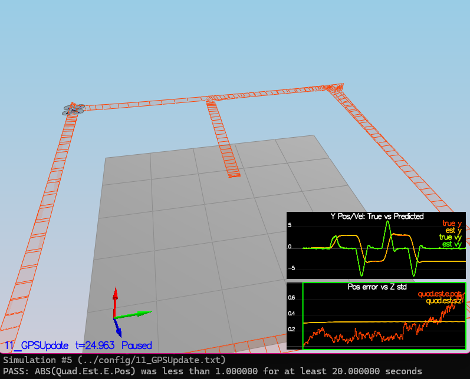
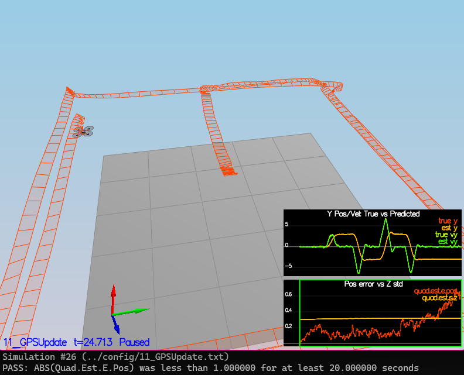
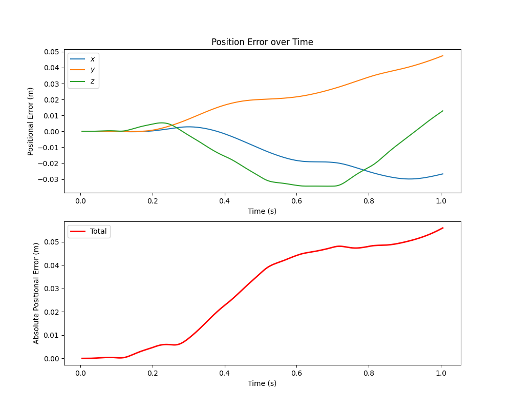
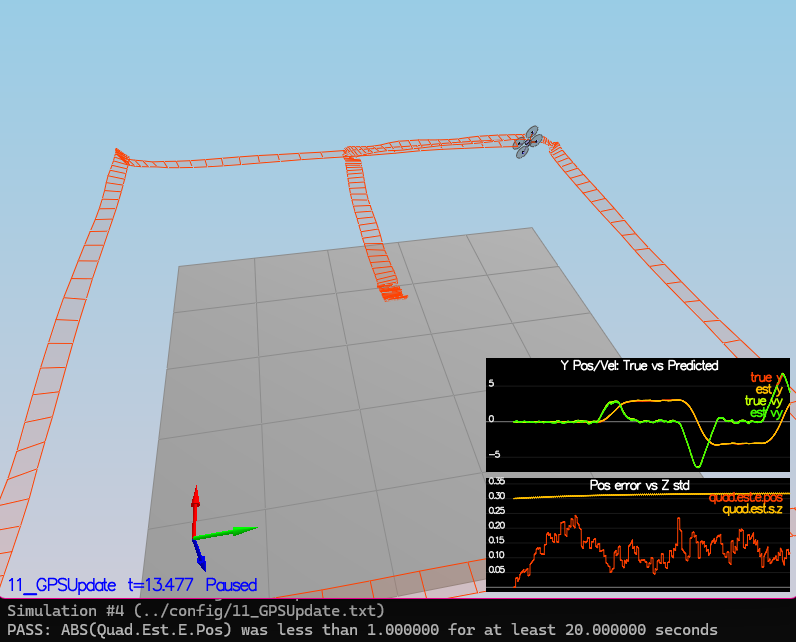

# Project: Estimation Write Up

## Step 1: Sensor Noise
_Rubric Point: Determine the standard deviation of the measurement noise of both GPS X data and Accelerometer X data._

I extracted the data from the graphs using the following Python script:

```python
import numpy as np
import pandas as pd

graph1 = pd.read_csv('./FCND-Estimation-CPP/config/log/Graph1.txt', header=0)
graph2 = pd.read_csv('./FCND-Estimation-CPP/config/log/Graph2.txt', header=0)

print(f"{'='*10}GPS{'='*10}\n{graph1.describe()}")
print(f"{'='*10}Accelerometer{'='*10}\n{graph2.describe()}")
```

This allowed me to find the standard deviation of each output:

Standard Deviation of `Quad.GPS.X`$ = 0.714951$

Standard Deviation of `Quad.IMU.AX`$ = 0.488860$

Then I input these values into `config/6_Sensornoise.txt` as the variables `MeasuredStdDev_GPSPosXY` and `MeasuredStdDev_AccelXY`.




## Step 2: Attitude Estimation
_Rubric Point: Implement a better rate gyro attitude integration scheme in the UpdateFromIMU() function._

`src\QuadEstimatorEKF.cpp : lines 91-114`

I updated the `UpdateFromIMU` function using qaternions as in [Estimation for Quadrotors](https://www.overleaf.com/read/vymfngphcccj) Equations 43-45. I also normalised yaw in the range $[-\pi,\pi]$ to avoid sudden fluctuation between $0$ and $2\pi$.




## Step 3: Prediction Step
_Rubric Point: Implement all of the elements of the prediction step for the estimator._

`src\QuadEstimatorEKF.cpp : lines 171-183`

I updated the `PredictState` function by first converting the accelerometer readings from the body frame to the inertial frame, then applying [Estimation for Quadrotors](https://www.overleaf.com/read/vymfngphcccj) Equations 48-49 to obtain the transition function, using the control input:
$u_{t} = \begin{bmatrix}0\\\0\\\0\\\\ddot{x}\\\\ddot{y}\\\\ddot{z}\end{bmatrix}$

where $\ddot{x},\ddot{y},\ddot{z}$ are readings from the accelerometer, converted to the inertial frame.



`src\QuadEstimatorEKF.cpp : lines 207-213`

I then implemented the function `GetRbgPrime` using Equation 52 from [Estimation for Quadrotors](https://www.overleaf.com/read/vymfngphcccj) and added code to predict the state covariance forward in `Predict`, writing the Jacobian $\prime{g}$ as in Equation 50-51 of [Estimation for Quadrotors](https://www.overleaf.com/read/vymfngphcccj).




## Step 4: Magnetometer Update
_Rubric Point: Implement the magnetometer update._

`src\QuadEstimatorEKF.cpp : lines 325-337`
`config\QuadEstimatorEKF.txt`

I first tuned the yaw standard deviation in the EKF Estimator to capture the yaw error drift, settling on $QYawStd = 0.25$. I then updated the function `UpdateFromMag`, taking the error between the measured and estimated yaw, then clipping it in the range $[-\pi,\pi]$ to avoid sudden jumps in the error around $\phi=2\pi$. I then added this error to the measured state and set the $\prime{h}$ matrix to only consider the yaw term, as in Equations 56-58 of [Estimation for Quadrotors](https://www.overleaf.com/read/vymfngphcccj).




## Step 5: Closed Loop + GPS Update
_Rubric Point: Implement the GPS update._

`src\QuadEstimatorEKF.cpp : lines 295-306`
`config\QuadEstimatorEKF.txt`

To align with the standard deviation of the filter, I first used the same Python script as in Step 1 to fidn the standard deviation of the estimated positions and velocities.

Standard Deviation of `Quad.Est.Y`$ = 0.000151$

Standard Deviation of `Quad.Est.VY`$ = 0.000139$

Standard Deviation of `Quad.Est.Z`$ = 6.754774$

Standard Deviation of `Quad.Est.VZ`$ = 6.175180$

I used these as starting points to tune the process noise model as follows:

QPosXYStd $= 0.05$

QPosZStd $= 0.05$

QVelXYStd $= 0.25$

QVelZStd $= 0.1$

QYawStd $= 0.25$

I then updated the function `UpdateFromGPS` by populating $z_t$ and $\prime{h(x_t)}$ using Equations 53 and 55 from [Estimation for Quadrotors](https://www.overleaf.com/read/vymfngphcccj).



Finally, I set `Quad.UseIdealEstimator = 0` and verified that the simulation was passed with the realistic EKF.
The final flight settings are included in the file `11_GPSUpdate.txt`.



The figure below shows that the positional error does not rise to above 1m, even with the realistic dynamics and EKF. This was calculated as:  
  
$e_{abs} = +\sqrt{(x_{ref} - x)^{2} + (y_{ref} - y)^{2} + (z_{ref} - z)^{2}}$




## Step 6: Adding Your Controller
_Rubric Point: De-tune your controller to successfully fly the final desired box trajectory with your estimator and realistic sensors._

`src\QuadControl.cpp`
`config\QuadControlParams.txt`

Finally, I implemented my controller from the previous project, and tuned the values down to pass the scenarios. I only changed position and velocity gains, as follows:

**Position control gains**
kpPosXY $= 18$
kpPosZ $= 70$
KiPosZ $= 18$

**Velocity control gains**
kpVelXY $= 8$
kpVelZ $= 70$


